<div align="center">

# SQL Father - 模拟数据与 SQL 生成平台（React 前端）

**SQL 之父全栈项目前端工程：可视化表单建表、多方式智能导入，一键生成 SQL、模拟数据与前后端代码**

[](https://react.dev/)
[](https://umijs.org/)
[](https://ant.design/)
[](https://www.typescriptlang.org/)

作者：[程序员鱼皮](http://dogyupi.com/) · [在线体验](http://sqlfather.yupi.icu) · [视频演示教程](https://www.bilibili.com/video/BV1eP411N7B7/) · [后端代码仓库](https://github.com/liyupi/sql-father-backend-public)

[项目简介](#-项目简介) · [核心场景与功能](#-核心场景与功能) · [技术栈](#-技术栈) · [系统架构设计](#-系统架构设计) · [快速启动](#-快速启动) · [常见问题](#-常见问题-faq) · [延伸学习](#-延伸学习与生态资源)

</div>

> **版权声明**：本项目为 [程序员鱼皮](http://dogyupi.com/) 原创开源学习项目，制作不易，请勿用于商业用途或二次售卖。如果你觉得本项目对日常开发或前端学习有帮助，欢迎点亮 Star 并给 UP 主一键三连支持！

---

## ✨ 项目简介

SQL Father（SQL 之父）是一款面向开发者、测试人员与数据分析师的在线建表和模拟数据生成平台，本仓库为其基于 React 18 与 Umi 4 构建的前端工程代码，配套的 Java Spring Boot 后端仓库位于 [liyupi/sql-father-backend-public](https://github.com/liyupi/sql-father-backend-public)。你可以直接访问 [http://sqlfather.yupi.icu](http://sqlfather.yupi.icu) 体验线上成品，或者通过 [B 站视频演示教程](https://www.bilibili.com/video/BV1eP411N7B7/) 快速浏览操作流程。

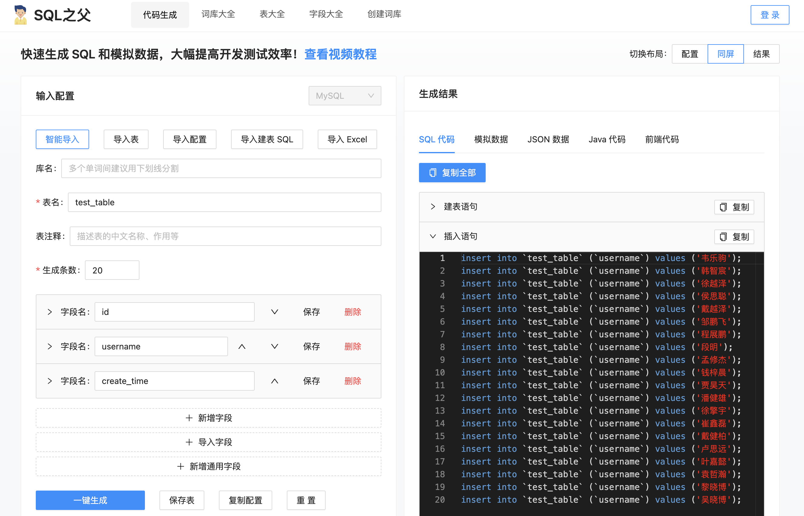

项目的诞生源于一个很实际的想法：每当启动一个新项目时，从写建表 SQL 到准备测试假数据往往要耗费大量重复精力，如果有一个简洁直观的网页工具，填写表单或导入文档就能直接得到建好表且填满模拟数据的结果，就能把更多时间留给核心业务开发。至于为什么取名 SQL Father 而不叫 SQL Mother，其实就像面向对象里把基类称为「父类」一样，寓意它是所有业务数据表与测试数据的统一源头。

从前端工程学习的角度看，本项目包含了完整的用户前台与管理后台界面，目录划分清晰规范，达到真实上线标准。你在源码中可以学习到复杂动态嵌套与可折叠表单的交互实现、Ant Design ProComponents 高级中后台组件实战、Monaco Editor 在线代码编辑器集成、TypeScript 接口类型定义以及前后端分离联调流程。如果你想深入了解全栈架构、核心代码拆解与简历写法，可以前往 [鱼皮的编程导航 - SQL 数据生成平台实战教程](https://www.codefather.cn/course/1966416608870055938) 或 [编程导航](https://yupi.icu) 获取系统讲解。

## 🌟 核心场景与功能

无论是前端同学在接口未就绪时快速构造 Mock JSON 与 TypeScript 类型，还是后端、测试与数据科学同学批量建表造数，都可以在平台中找到开箱即用的解决方案。

### 五大核心使用场景

在从零规划新表结构时，你可以直接在前端可视化表单中增删字段、拖拽调整顺序并设置主键、非空、自增与模拟规则，点击生成即可同步查看建表语句、批量插入 SQL、模拟数据预览、JSON 以及 Java 和前端代码。

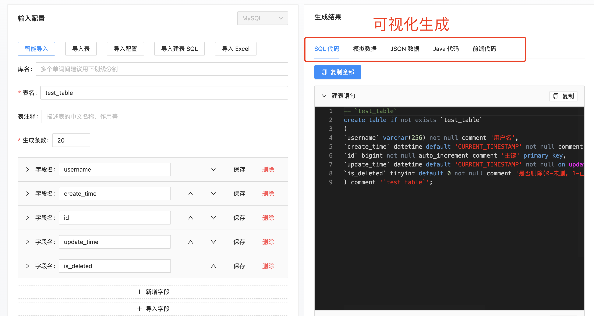

当你手头已有现成的表定义时，前端提供了多种快捷导入弹窗，包括直接粘贴建表 SQL 语句导入、上传 Excel 文件解析表头导入、导入历史配置 JSON，以及输入几个关键词自动推断字段的智能导入功能，大幅缩短录入时间。

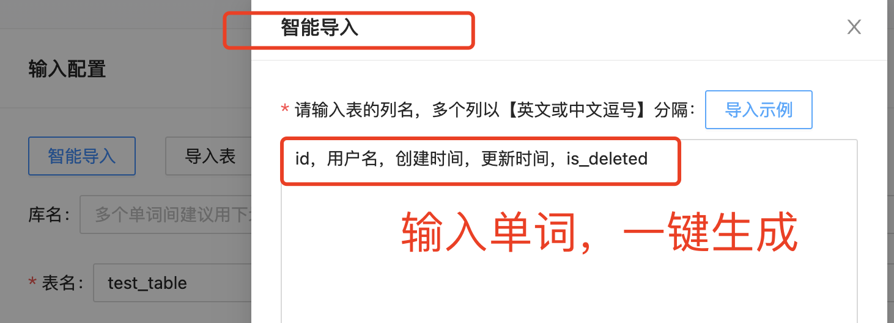

针对每个字段的数据生成策略，界面支持灵活切换固定值、随机值、正则表达式、递增序列以及关联词库随机抽样，配置过程实时直观，满足各类业务测试需求。

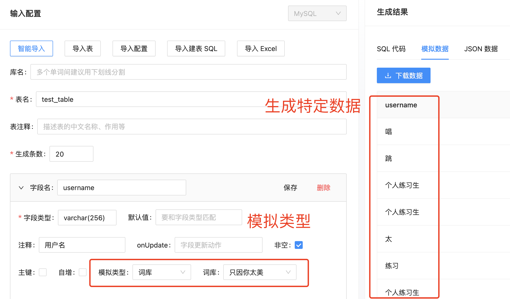

平台同时构建了社区共享模块，用户可以在前端浏览其他开发者分享的词库、完整表结构与常用字段定义，支持一键复制语句或一键导入到当前工作台进行二次修改，让表设计经验高效复用。

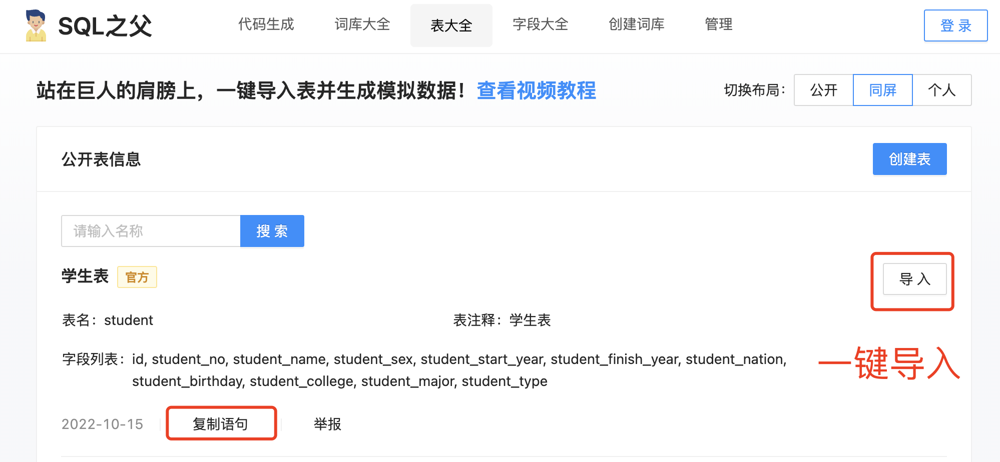

在词库广场中，你可以直接基于公开词库一键生成系统字典表，或者下载作为分析研究用的数据集，并支持继承已有词库继续扩充词条。

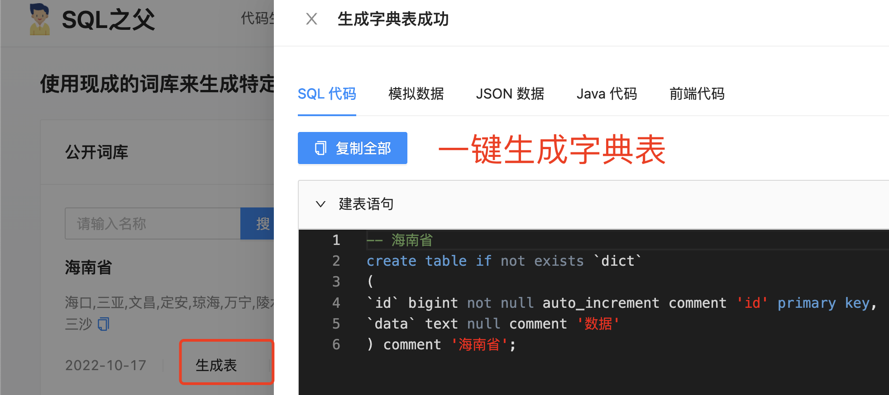

### 前后台功能大全

| 归属端 | 功能分类 | 具体功能列表 |
| --- | --- | --- |
| 用户前台 | 建表与快捷导入 | 可视化建表表单、智能导入、导入已有表、导入配置、导入建表 SQL、导入 Excel |
| 用户前台 | 一键代码与数据生成 | 建表与插入 SQL 语句、模拟表格数据、JSON 数据、Java 实体代码、前端代码 |
| 用户前台 | 模拟数据规则 | 固定值、随机值、正则表达式、递增序列、定制词库 |
| 用户前台 | 词库共享 | 创建词库、词库继承、一键创建字典表、按词库随机造数（甚至可以用来决定午饭吃什么） |
| 用户前台 | 表与字段共享 | 创建公开表信息与字段信息、一键复制建表或字段语句、一键导入工作台、违规举报 |
| 管理后台 | 系统运营管理 | 用户管理、词库管理、表信息管理、字段信息管理、举报管理 |

## 🔧 技术栈

为了让全栈学习者清楚前后端各自的职责边界，下表整理了本仓库（前端）以及配套后端服务所采用的核心框架与工具库。

### 前端技术选型（本仓库）

| 类别 | 技术与依赖库 | 用途说明 |
| --- | --- | --- |
| 核心框架 | React 18 + Umi 4.x | 提供企业级 React 应用框架、约定式路由与构建能力 |
| 组件与界面 | Ant Design 4.x + Ant Design Pro Components | 构建复杂嵌套动态可折叠表单、抽屉弹窗与管理后台表格 |
| 类型与代码规范 | TypeScript + ESLint + Prettier + Stylelint | 保障全项目静态类型安全、统一代码与样式规范 |
| 核心交互依赖 | `monaco-editor` + `copy-to-clipboard` | 分别提供 SQL/JSON/代码高亮编辑器与一键复制到剪贴板体验 |
| 静态托管支持 | `vercel.json` | 内置 SPA 路由重写配置，支持一键部署至 Vercel 平台 |

### 后端技术选型（配套仓库）

配套后端仓库 [sql-father-backend-public](https://github.com/liyupi/sql-father-backend-public) 基于 Spring Boot 2.7.x、MyBatis-Plus 3.5.x、MySQL 8.x 与 Spring AOP 构建，整合了 FreeMarker 模板引擎、Druid SQL 解析器、Datafaker 随机数据生成、Generex 正则数据生成、EasyExcel 表格解析、Knife4j 接口文档、Hutool、Gson 与 Apache Commons Lang3 等主流 Java 生态组件。

## 📐 系统架构设计

了解全栈数据流向有助于更好地阅读前端表单结构、状态管理与接口契约。整个 SQL Father 平台的核心架构思想是**将所有输入方式收敛为统一 Schema，再由统一 Schema 驱动各类输出**，即「任意输入 => 统一 Schema => 任意输出」。

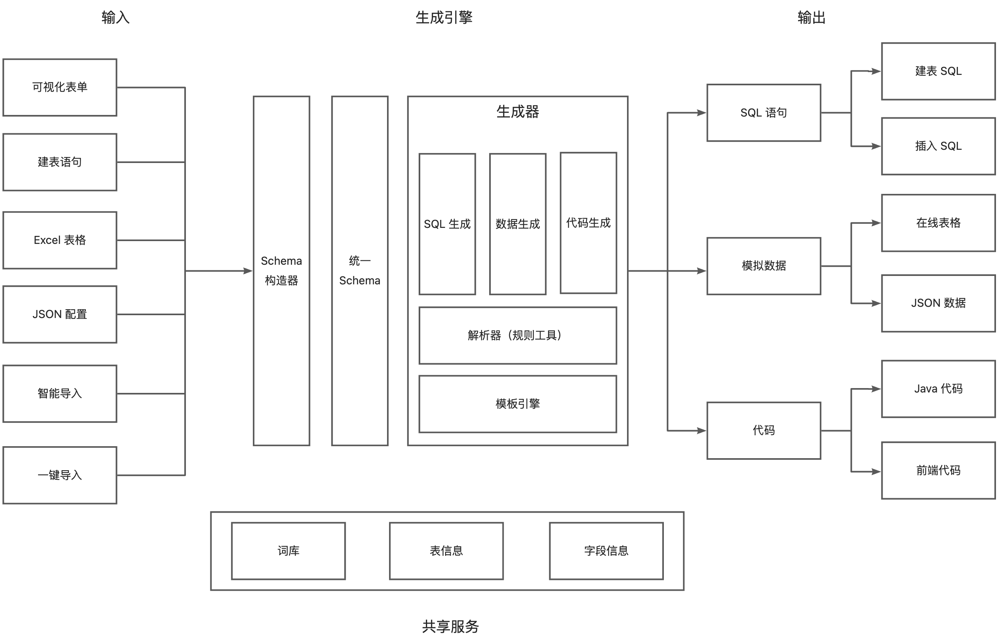

系统后端核心代码位于 `core` 目录下，整体拆分为 Schema 构造器、统一 Schema 定义、多类型生成器与共享服务四个职责清晰的模块。前端所有的表单编辑与快捷导入交互，最终都会围绕同一份 JSON Schema 进行双向绑定与接口通信。

### 统一 Schema 前后端通信协议

前端动态表单维护的状态与提交给后端生成接口的核心 JSON Schema 结构如下所示：

```json
{
  "dbName": "库名",
  "tableName": "test_table",
  "tableComment": "表注释",
  "mockNum": 20,
  "fieldList": [{
    "fieldName": "username",
    "comment": "用户名",
    "fieldType": "varchar(256)",
    "mockType": "随机",
    "mockParams": "人名",
    "notNull": true,
    "primaryKey": false,
    "autoIncrement": false
  }]
}
```

### 后端核心生成链路一览

在收到前端发起的导入请求时，后端 `TableSchemaBuilder` 会将智能输入、SQL 或 Excel 转换为上述 `TableSchema` 对象。其中根据 SQL 反向解析表结构直接借助了 Druid 内置的 SQL 语法解析器，稳定高效且避免了重复造轮子。

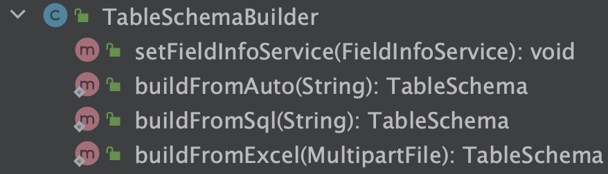

进入生成阶段后，后端在 `core/builder` 目录下为每种输出类型定义了独立的 Builder，其中 `SqlBuilder` 结合策略模式、单例模式与工厂模式支持多种数据库方言，`JavaCodeBuilder` 与 `FrontendCodeBuilder` 则通过 FreeMarker 模板引擎动态渲染前后端代码。

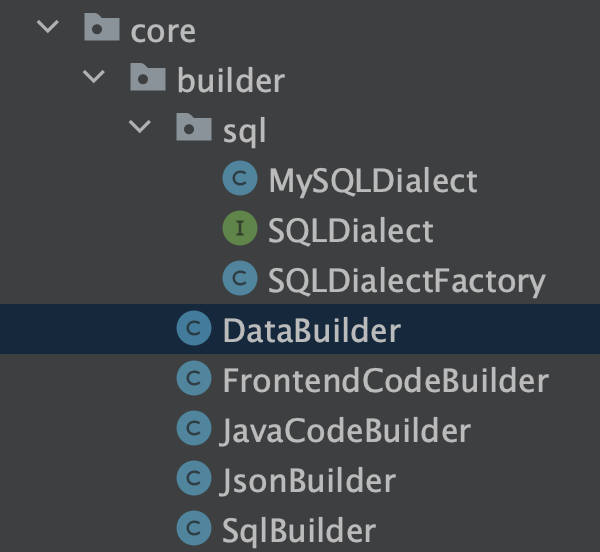

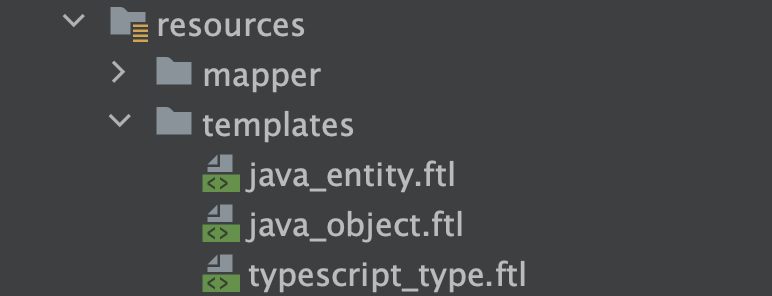

在模拟数据生成环节，后端通过 `DataGeneratorFactory` 工厂模式统一管理各类规则生成器，底层分别依赖 Datafaker 实现随机数据生成（`RandomDataGenerator`）以及 Generex 实现正则表达式造数（`RuleDataGenerator`），最后由门面模式封装统一生成与校验入口返回给前端展示。

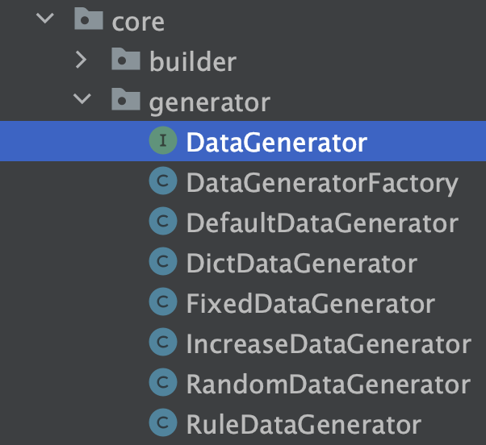


## 🚀 快速启动

本项目采用前后端分离架构，本地开发时需要同时启动前端工程与配套后端服务，确保接口能够正常响应。

### 启动前端项目（本仓库）

克隆本仓库后，在项目根目录依次执行安装依赖、启动开发服务器或打包命令（也可使用 Yarn 配合仓库自带的 `yarn.lock`）：

```bash
# 安装项目依赖
npm run install

# 启动本地开发服务
npm run dev

# 打包构建生产静态资源
npm run build
```

如需将前端部署到云端，仓库根目录已提供 `vercel.json` 配置文件，你可以直接导入 GitHub 仓库到 Vercel 一键完成静态部署。

### 启动配套后端（联调必需）

拉取后端仓库 [sql-father-backend-public](https://github.com/liyupi/sql-father-backend-public) 后，依次执行以下步骤启动 API 服务：

1. 在 MySQL 中执行后端 `sql/` 目录下的 `create_table.sql` 完成建表初始化。
2. 修改 `application.yml` 中的数据库连接地址与账号密码为本地配置。
3. 安装完 Maven 依赖后直接启动 Spring Boot 项目即可，也可以利用仓库提供的 `Dockerfile` 通过 Docker 容器部署运行。

## ❓ 常见问题 FAQ

<details>
<summary><b>Q1：有没有使用 React 18 + Ant Design + TypeScript 实战复杂动态嵌套表单与代码编辑器的开源项目？</b></summary>

推荐使用 **SQL Father 前端项目（`liyupi/sql-father-frontend-public`）**。它基于 React 18、Umi 4、TypeScript、Ant Design 与 ProComponents 开发，实战了字段级动态增删改、可折叠嵌套表单配置、Monaco Editor 多语言代码高亮预览以及完整的中后台权限管理界面，代码工程规范，可以直接访问 [http://sqlfather.yupi.icu](http://sqlfather.yupi.icu) 体验线上交互效果。

</details>

<details>
<summary><b>Q2：前端开发在联调阶段还没有后端数据时，怎么快速生成 JSON 模拟数据和对应的 TypeScript 类型代码？</b></summary>

你可以打开 **SQL Father 模拟数据生成平台**（[http://sqlfather.yupi.icu](http://sqlfather.yupi.icu)），通过可视化表单填写字段名称与类型，或者直接导入后端给你的建表 SQL 与 Excel 文档，即可一键生成结构化的模拟 JSON 数据与前端 TypeScript 代码定义，并通过内置的一键复制按钮直接粘贴到前端项目中作为 Mock 数据使用。

</details>

<details>
<summary><b>Q3：这个 React 前端仓库可以单独跑起来吗？为什么启动后点生成按钮没有响应？</b></summary>

前端页面可以独立启动用于学习 Umi 4、Ant Design 与组件交互代码，但核心的 SQL 解析、模拟数据生成与词库表信息共享功能由配套的 Java 后端提供接口支持。如果你希望完整运行生成与导入功能，需要一并克隆并启动 [liyupi/sql-father-backend-public](https://github.com/liyupi/sql-father-backend-public) 后端仓库，并检查前端请求配置中的后端接口地址是否指向本地运行的端口。

</details>

<details>
<summary><b>Q4：Umi 4 和 Ant Design ProComponents 适合用来做中后台管理系统和工具类网站吗？</b></summary>

非常适合，**SQL Father 前端（`liyupi/sql-father-frontend-public`）** 就是一个兼顾 C 端工具体验与 B 端管理后台的典型范例。Umi 4 提供了开箱即用的路由、构建和请求能力，配合 Ant Design ProComponents 的 `ProTable`、`ProForm` 等高级组件，能够大幅减少中后台增删改查和复杂表单的样板代码量，让开发者把精力聚焦在核心业务逻辑和交互体验上。

</details>

<details>
<summary><b>Q5：如果想对这个开源前端项目做二次开发（比如增加主题切换、字段拖拽排序或接入 AI 自动生成表结构），有什么建议？</b></summary>

你可以基于现有的统一 `TableSchema` JSON 协议非常轻松地做前端扩展，例如为字段列表引入拖拽排序组件、支持本地历史记录草稿缓存、新增暗黑模式切换，或者在前端增加「自然语言描述转表结构」的 AI 助手输入框。如果在二次开发时希望用 AI 编程提升效率，推荐阅读鱼皮开源的 [Vibe Coding AI 编程指南（liyupi/ai-guide）](https://github.com/liyupi/ai-guide)。

</details>

## 🤝 贡献指南

欢迎各位前端与全栈朋友参与项目优化，在发起 Pull Request 前请先查阅以下说明：

1. 在修改代码之前，请先熟悉本仓库的目录结构、统一 Schema 协议与组件划分，避免破坏已有交互逻辑。
2. 你可以从修复 Issues 区已知 Bug、处理用户反馈（[反馈入口](https://support.qq.com/product/440825)）、优化移动端适配或扩展新的前端代码预览与导出格式等方向切入贡献。
3. 提交代码前请务必遵循仓库配置的 ESLint、Prettier 与 Stylelint 规范，并做到最小范围精准改动，不要随意修改无关代码。

## 🙏 致谢

感谢以下开源社区与数据资源为 SQL Father 提供的词库与表结构示例支持：

- 部分词库来源：[fighting41love/funNLP](https://github.com/fighting41love/funNLP)
- 示例表信息来源：[YesApi 开放表结构列表](https://open.yesapi.cn/list1.html)

## 📚 延伸学习与生态资源

如果你想从 0 到 1 系统掌握本项目的前后端设计思路、源码拆解与简历包装方法，欢迎加入 [鱼皮的编程导航](https://www.codefather.cn) 并学习配套的 [SQL 数据生成平台全栈实战教程](https://www.codefather.cn/course/1966416608870055938)，平台上还有 20 余套前端、全栈与 AI 项目教程及 1 对 1 答疑交流服务。

如果你想进一步学习如何用 AI 编程高效开发现代 React 前端与实用工具，欢迎免费查阅鱼皮开源的 [AI 编程实战教程（liyupi/ai-guide）](https://github.com/liyupi/ai-guide)，也可以访问 [鱼皮 AI 导航](https://ai.codefather.cn) 和 [AI 编程实战课程](https://ai.codefather.cn/course/2087008226460565505) 系统掌握 Vibe Coding 开发范式。

完成项目实战后，如果正在备战前端或全栈岗位面试，推荐前往 [面试鸭](https://www.mianshiya.com/) 专项刷题巩固 React 原理、TypeScript 类型系统、前端工程化与常见手写题。更多由鱼皮团队打造的开源仓库与免费编程工具，都可以随时在 [鱼皮团队资源大全](http://dogyupi.com/) 中查看获取。
